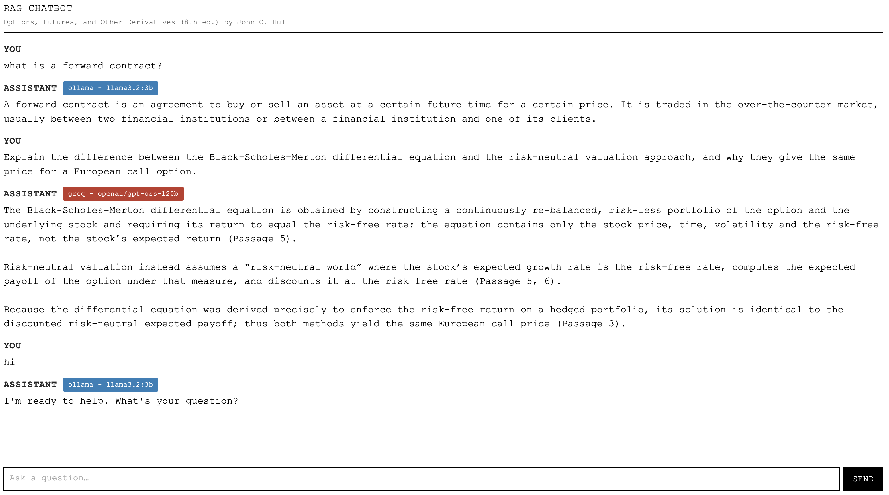

# RAG chatbot for Hull's Derivatives with Jev-based LLM routing



A Retrieval-Augmented Generation (RAG) chatbot built to answer questions about John C. Hull's *Options, Futures, and Other Derivatives (8th Edition)*.

The project combines document retrieval, large language models, and **JEV-based query routing** to select an appropriate model for each question. It runs in Docker and exposes a FastAPI backend.

## Features

- **Document-based question answering:** Retrieves relevant passages from the textbook before generating an answer.
- **RAG pipeline:** Uses PDF extraction, text chunking, embeddings, and a Chroma vector database.
- **Intelligent model routing:** Uses JEV to route questions based on their complexity.
- **Large-model inference:** Uses Groq's API with `openai/gpt-oss-120b`.
- **Small-model inference:** Uses Ollama with `llama3.2:3b`.
- **REST API:** Serves questions and answers through FastAPI.
- **Dockerized deployment:** Runs the API and Ollama as separate containers.
- **Persistent storage:** Uses Docker volumes for the Chroma database and Ollama models.

## Architecture

```text
                   User Question
                         |
                         v
                 FastAPI Backend
                         |
                         v
                 RAG Retrieval Layer
                         |
              +----------+----------+
              |                     |
              v                     v
        PDF / Chroma DB      Retrieved Context
                                    |
                                    v
                              JEV Router
                                    |
                      +-------------+-------------+
                      |                           |
                      v                           v
                Simple Query                Complex Query
                      |                           |
                      v                           v
              Ollama: llama3.2:3b      Groq: gpt-oss-120b
                      |                           |
                      +-------------+-------------+
                                    |
                                    v
                              Final Answer
```

JEV is intended to select a suitable model for a question. Both model paths use the retrieved textbook context to ground their answers.

## Tech Stack

| Component | Technology |
|---|---|
| Backend API | FastAPI |
| Language | Python |
| Document loading | PyPDFLoader |
| Text splitting | RecursiveCharacterTextSplitter |
| Embeddings | Sentence Transformers |
| Vector database | Chroma |
| Large language model | `openai/gpt-oss-120b` via Groq |
| Small language model | `llama3.2:3b` via Ollama |
| Model routing | JEV |
| Containerization | Docker and Docker Compose |

## Project Structure

```text
rag-chatbot/
├── backend/
│   ├── main.py              # FastAPI application and model routing
│   └── rag.py               # PDF ingestion, embeddings, and retrieval
├── hulls-derivatives.pdf    # Source textbook PDF (provide locally)
├── chroma_db/               # Local Chroma data, if generated
├── Dockerfile
├── docker-compose.yml
├── requirements.txt
├── .env                     # API keys; not committed
├── .gitignore
└── README.md
```

The exact structure may vary as the project evolves.

## Prerequisites

Install the following before running the project:

- [Docker Desktop](https://www.docker.com/products/docker-desktop/) with Docker Compose
- A Groq API key
- The source textbook PDF, placed at the path expected by `backend/rag.py`

The small model runs inside the Ollama container, so a separate host installation of Ollama is not required when using the provided Compose configuration.

## Setup

### 1. Clone the repository

```bash
git clone <your-repository-url>
cd rag-chatbot
```

If you are working from an existing local project, skip this step.

### 2. Configure environment variables

Create a `.env` file in the project root:

```env
GROQ_API_KEY=your_groq_api_key
TYPESAFE_API_KEY=your_typesafe_api_key
```

Replace the placeholder values with valid credentials. Keep `.env` out of version control.

`TYPESAFE_API_KEY` is only necessary if your current implementation uses it; otherwise, remove the unused variable from your configuration.

### 3. Add the textbook PDF

Place the PDF in the project root with the expected filename:

```text
hulls-derivatives.pdf
```

The ingestion code expects this path:

```python
PROJECT_ROOT / "hulls-derivatives.pdf"
```

Make sure you have the rights required to store and process the PDF.

### 4. Build and start the containers

```bash
docker compose build
docker compose up -d
```

To inspect container status:

```bash
docker compose ps
```

To follow the API logs:

```bash
docker compose logs -f api
```

To follow the Ollama logs:

```bash
docker compose logs -f ollama
```

### 5. Download the small model

Pull the model into the running Ollama container:

```bash
docker compose exec ollama ollama pull llama3.2:3b
```

Verify that it is available:

```bash
docker compose exec ollama ollama list
```

The first download can take some time. The Ollama model is stored in the persistent `ollama_data` Docker volume.

### 6. Build the vector database

The first ingestion run may take several minutes because the application must extract the PDF text, split it into chunks, generate embeddings, and index them in Chroma.

If indexing is triggered automatically by the application, monitor the API logs:

```bash
docker compose logs -f api
```

Otherwise, invoke the ingestion function from the API container:

```bash
docker compose exec api python -c \
"from backend.rag import build_vectorstore; vs = build_vectorstore(); print('Stored chunks:', vs._collection.count())"
```

A positive chunk count confirms that the collection contains indexed documents. If the collection is empty, check the PDF path, ingestion logs, and persistent Chroma volume.

### 7. Access the API

Once the API is running, open:

- API base URL: `http://localhost:8000`
- Interactive Swagger documentation: `http://localhost:8000/docs`

The available endpoints depend on the routes defined in `backend/main.py`.

## How It Works

### 1. Document ingestion

The application loads the textbook PDF using PyPDFLoader. The extracted pages are split into overlapping text chunks using RecursiveCharacterTextSplitter.

### 2. Embedding and indexing

Each chunk is converted into a vector using `sentence-transformers/all-MiniLM-L6-v2` and stored in Chroma for semantic retrieval.

### 3. Retrieval

When a user submits a question, the application retrieves the most relevant textbook passages and passes them to the language model as context.

### 4. JEV-based routing

JEV is intended to choose which model handles the query:

- **Small-model route:** Ollama's `llama3.2:3b` for simpler questions.
- **Large-model route:** Groq's `openai/gpt-oss-120b` for more complex questions.

### 5. Answer generation

The selected model receives the question and retrieved passages. The system prompt instructs the model to answer concisely and acknowledge when the available context is insufficient.

## Example API Request

If your FastAPI application exposes a `POST /chat` endpoint accepting a JSON field named `question`, a request would look like this:

```bash
curl -X POST http://localhost:8000/chat \
  -H "Content-Type: application/json" \
  -d '{
    "question": "What is the relationship between a futures price and the forward price?"
  }'
```

The endpoint and request schema must match your implementation in `backend/main.py`.

A response may contain fields similar to:

```json
{
  "answer": "Answer generated using the retrieved textbook context.",
  "model": "openai/gpt-oss-120b",
  "route": "large",
  "context_preview": "Retrieved textbook passages..."
}
```

This is an illustrative response, not a guarantee of the exact output.

## Useful Commands

```bash
# Start the application
docker compose up -d

# Rebuild the API image after code changes
docker compose build --no-cache api

# Restart services
docker compose restart

# View API logs
docker compose logs -f api

# View Ollama logs
docker compose logs -f ollama

# Check indexed chunk count
docker compose exec api python -c \
"from backend.rag import build_vectorstore; print(build_vectorstore()._collection.count())"

# List locally available Ollama models
docker compose exec ollama ollama list

# Stop services without deleting persistent volumes
docker compose down
```

To remove containers and persistent volumes, use `docker compose down -v` only when you intentionally want to delete the stored Chroma and Ollama data.

## Troubleshooting

### No relevant passages found

Check that:

- The PDF exists at the expected path.
- PDF ingestion completed successfully.
- The Chroma collection contains a positive number of chunks.
- The application is using the correct persistent volume and collection.

### Ollama model not found

Pull the model into the Ollama container:

```bash
docker compose exec ollama ollama pull llama3.2:3b
```

### Groq API errors

Verify that `GROQ_API_KEY` is set correctly and that the configured model is available to your account.

### Code changes are not reflected

Ensure the API service has a `build:` configuration in `docker-compose.yml`, then rebuild and recreate it:

```bash
docker compose build --no-cache api
docker compose up -d
```

### Container cannot connect to Ollama

Inside Docker Compose, the API should use the service hostname:

```env
OLLAMA_HOST=http://ollama:11434
```

Using `localhost:11434` from inside the API container would point back to the API container itself.

## Current Limitations

- Answer quality depends on PDF extraction and retrieval quality.
- A relevant answer may not be generated if the required passage is not retrieved.
- The small and large models may produce different answers.
- Initial model downloads and PDF indexing can increase startup time.
- JEV routing quality needs to be evaluated against a representative set of questions.

## Future Improvements

- Evaluate JEV routing accuracy and compare it with always-small and always-large baselines.
- Measure latency, token usage, API costs, and answer quality.
- Add retrieval metrics such as Recall@k and Mean Reciprocal Rank.
- Add answer-grounding and citation evaluation.
- Include page-level citations in generated answers.
- Add automated tests for ingestion, retrieval, routing, and API endpoints.
- Add a frontend for interactive question answering.

## Disclaimer

This project is intended for educational and research purposes. It is not financial, investment, or trading advice. Generated answers should be checked against the original textbook and other authoritative sources.

## License

Add a license appropriate for your code and confirm that you have permission to distribute any bundled documents or other third-party materials.
